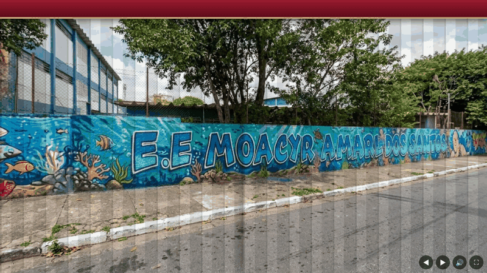
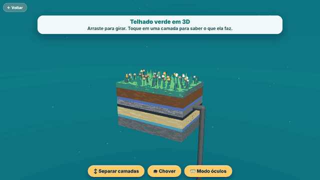
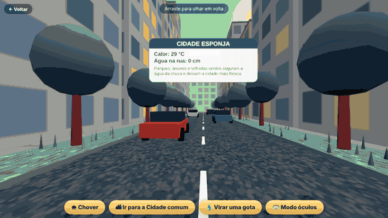

<p align="center">
  
</p>

<p align="center">
  <b>Apresentação interativa sobre telhado verde e Cidade Esponja</b><br>
  Culminância da Eletiva · E.E. Moacyr Amaral dos Santos (PEI)
</p>

<p align="center">
  
</p>

## O que é

Uma apresentação em **um único arquivo HTML**, feita para a TV de 70" e que também funciona no celular.
Ela mostra por que a cidade alaga e esquenta, como a **Cidade Esponja** ajuda e como um **telhado verde** funciona por dentro.

**Apresentam:** Prof. Domingos (História) e Prof. Thiago (Matemática).

## Como usar

1. Abra o `index.html` no navegador (Chrome é o melhor).
2. Clique em **Começar**: a cortina abre com som de teatro.
3. Avance com `→`, `Espaço` ou clique.

| Tecla | O que faz |
|---|---|
| `→` / `Espaço` / `Enter` | Avançar |
| `←` / `Backspace` | Voltar |
| `F` | Tela cheia |
| `M` | Liga/desliga o som |
| 🏠 (botão) | Volta para a tela inicial |

No celular, deslize para os lados.

## Ver em 3D / óculos

Na tela inicial, o botão **🥽 Ver em 3D / óculos** abre o `vr.html`: o telhado verde em 3D, em um único arquivo HTML.

<p align="center">
  
</p>

- **Arraste** para girar e **toque em uma camada** para ver o que ela faz.
- **Separar camadas** abre as 8 camadas, uma acima da outra.
- **Chover** mostra a água passando pelas camadas e saindo pelo cano.
- **Modo óculos**: coloque o celular de lado no óculos e escolha **olhando para o botão** por cerca de 1,5 s. No computador, arraste ou use as setas para olhar e clique para escolher. `Esc` sai.

## Entrar na cidade (360°)

Na tela inicial, o botão **🏙 Entrar na cidade (360°)** abre o `cidade.html`: o aluno fica no meio da rua e olha em volta, na tela ou no óculos.

<p align="center">
  
</p>

- **Cidade comum:** com chuva, a água sobe na rua, o bueiro transborda e o calor aumenta.
- **Cidade Esponja:** a mesma rua com árvores, jardins e telhados verdes: a água é absorvida e fica mais fresco.
- **Virar uma gota:** desce pelas 8 camadas do telhado verde, com explicação em cada uma.
- **Modo óculos:** olhe para um botão por cerca de 1,5 s. No computador, arraste (ou use as setas) e clique. `Esc` sai.

## Os slides

1. Cortina e abertura com nomes e projeto
2. Por que a cidade alaga e esquenta?
3. A Cidade Esponja
4. E se a nossa escola tivesse um telhado verde? (antes e depois)
5. O telhado verde por dentro (8 camadas)
6. Por que vale a pena?
7. Vamos ver de perto? (cards com links para o YouTube)
8. Desafio da turma (duas perguntas para pensar)
9. Obrigado!

## Como editar

Dentro do `index.html`, procure por `VIDEOS` e `TURMAS`:

```js
const VIDEOS=[
  {id:'_RLUUr9-cnY',titulo:'Como funciona uma cidade-esponja'},
  // troque o id pelo final do link do YouTube
];
const TURMAS=[]; // ex.: ['1ª série','2ª série']
```

## Publicar (GitHub Pages)

`Settings` → `Pages` → *Deploy from a branch* → `master` / `root`.

---

<p align="center">Feito com 💧 e 🌱 para a escola.</p>
